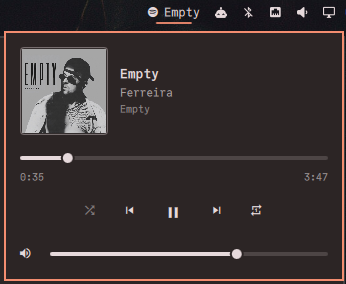

# Spotifyd Mini Player

Turn your Omarchy machine into a Spotify Connect speaker that you drive from
your phone, with a small mini-player in the bar.



Playback runs in [spotifyd](https://github.com/Spotifyd/spotifyd), the
lightweight Spotify Connect daemon packaged in Arch's `extra` repository. You
pick playlists in the Spotify app on your phone (or any other device) and choose
this computer as the speaker. The widget only shows what is playing and gives
you the controls you reach for at the desk:

- the Spotify icon and the current track title in the bar (dimmed while paused)
- click for a popup with cover art, title, artists and album
- a seek bar with elapsed and total time
- shuffle, previous, play/pause, next, repeat (off → context → track)
- a volume slider; click the speaker icon to mute and restore
- middle-click the bar icon to play or pause

It talks to the player only over MPRIS on the session D-Bus. There is no
Spotify Web API, so no developer app, no client ID, no login inside the widget,
no rate limits and nothing to build. Browsing, search and playlists stay in the
Spotify apps you already have.

The default player match is `spotify`, so the widget also works with the
official Spotify desktop client if that is what you run.

## Requirements

- Omarchy 4 (Quattro shell)
- Spotify Premium (spotifyd, like every Spotify Connect receiver, requires it)
- `spotifyd` from Arch's `extra` repository, which is built with MPRIS support

## Install

### 1. Set up spotifyd

```bash
omarchy pkg add spotifyd

mkdir -p ~/.config/spotifyd
cat > ~/.config/spotifyd/spotifyd.conf <<'EOF'
[global]
device_name = "Omarchy"
device_type = "computer"
backend = "pulseaudio"
bitrate = 320
volume_controller = "softvol"
use_mpris = true
dbus_type = "session"
EOF

systemctl --user enable --now spotifyd
```

`backend = "pulseaudio"` goes through PipeWire's PulseAudio layer, which
Omarchy ships, so audio follows your selected output.

On a home network that allows mDNS, the computer now shows up in the Spotify
app's device list on your phone, and picking it logs spotifyd in.

To make it appear on any network (university or office Wi-Fi, a different
network from your phone), log spotifyd in to your account once:

```bash
spotifyd authenticate
systemctl --user restart spotifyd
```

`spotifyd authenticate` runs Spotify's own login in your browser and stores
the session in `~/.cache/spotifyd`. Your password never goes through this
plugin.

### 2. Add the plugin

```bash
omarchy plugin add https://github.com/pierrecagne/omarchy-spotifyd.git --enable
```

The widget lands in the right section of the bar. Move it with, for example,
`omarchy bar move io.github.pierrecagne.spotifyd --section center --index 0`.

## Settings

Set these on the widget's entry in `~/.config/omarchy/shell.json`, or with
`omarchy bar set io.github.pierrecagne.spotifyd <key> <value>`.

| Key | Default | Meaning |
| --- | --- | --- |
| `player` | `spotify` | Case-insensitive substring of the player's D-Bus name. `spotify` matches spotifyd and the desktop client; `spotifyd` pins the widget to spotifyd. When several match, the one playing wins. |
| `maxTitleWidth` | `240` | Maximum width of the bar title in pixels; `0` shows only the icon. |

## Keybindings and scripting

The widget registers the IPC target `io.github.pierrecagne.spotifyd`:

```bash
omarchy-shell io.github.pierrecagne.spotifyd toggle        # open/close the popup on the focused monitor
omarchy-shell io.github.pierrecagne.spotifyd playPause
omarchy-shell io.github.pierrecagne.spotifyd next
omarchy-shell io.github.pierrecagne.spotifyd previous
omarchy-shell io.github.pierrecagne.spotifyd volumeUp      # spotifyd's own volume, ±5%
omarchy-shell io.github.pierrecagne.spotifyd volumeDown
omarchy-shell io.github.pierrecagne.spotifyd toggleMute
omarchy-shell io.github.pierrecagne.spotifyd toggleShuffle
omarchy-shell io.github.pierrecagne.spotifyd cycleRepeat
omarchy-shell io.github.pierrecagne.spotifyd status        # JSON snapshot
```

For example, in `~/.config/hypr/bindings.lua`:

```lua
o.bind("SUPER + ALT + S", "Spotify mini-player",
  "omarchy-shell io.github.pierrecagne.spotifyd toggle")
```

Media keys need nothing extra: Omarchy's built-in media service already
controls spotifyd through MPRIS.

Volume here is spotifyd's own volume, the same one your phone shows for this
device, not the computer's output level.

## Coming from the Omarchy Spotify plugin

If you used [stappmus/Omarchy-Spotify](https://github.com/stappmus/Omarchy-Spotify)
in its spotifyd fallback mode, spotifyd is already installed and logged in:

```bash
mkdir -p ~/.config/spotifyd
cp ~/.config/omarchy-spotify/spotifyd.conf ~/.config/spotifyd/spotifyd.conf
systemctl --user stop omarchy-spotifyd
systemctl --user enable --now spotifyd
omarchy plugin disable quickshell.spotify
```

Do not run that plugin's `uninstall.sh` or `remove-runtime.sh --purge`
afterwards: they delete `~/.cache/spotifyd`, which holds the login spotifyd
now uses. To keep the two receivers from ever running together, add
`Conflicts=omarchy-spotifyd.service` under `[Unit]` with
`systemctl --user edit spotifyd`.

## Privacy and permissions

The widget runs no processes, reads and writes no files, and makes no
network requests of its own. The only network traffic it causes is loading the
cover art from the URL in the player's metadata (Spotify's image CDN).
spotifyd itself connects to Spotify as any Spotify Connect speaker does.

## Remove

```bash
omarchy plugin remove io.github.pierrecagne.spotifyd
```

To remove spotifyd and its login as well:

```bash
systemctl --user disable --now spotifyd
omarchy pkg drop spotifyd
rm -rf ~/.config/spotifyd ~/.cache/spotifyd
```

## License

[MIT](LICENSE). Spotify is a trademark of Spotify AB; this project is not
affiliated with Spotify.
